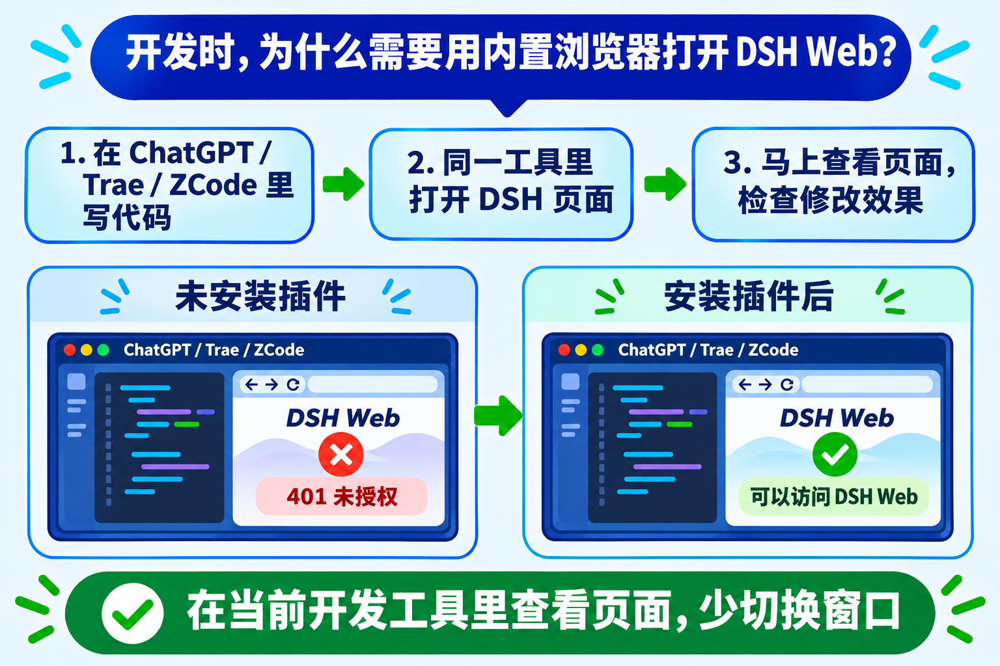
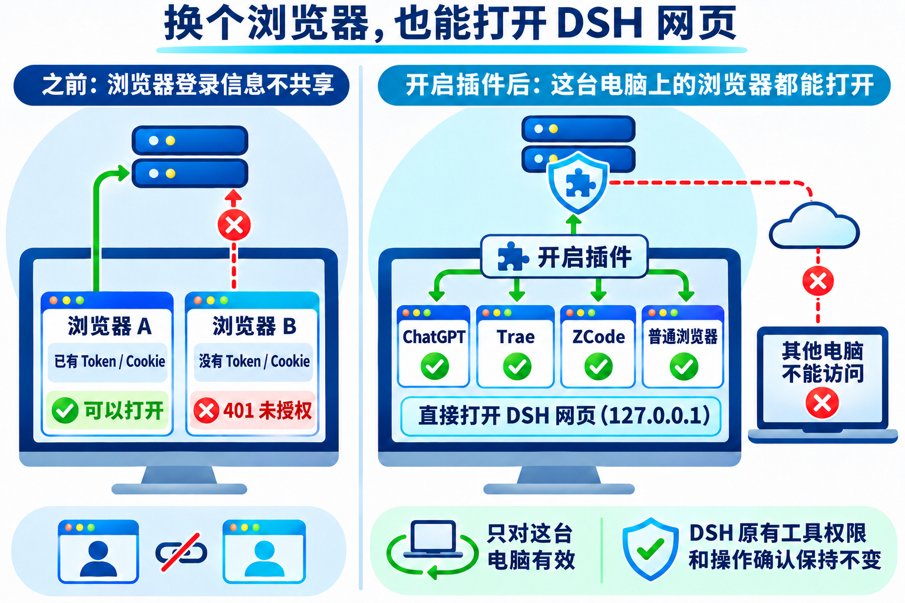

# DSH 插件十倍速开发 01｜让自动化插件直接操控内置浏览器里的 DSH Web

代码改好了。编程 AI 说问题修完了。你打开它所在工具的内置浏览器，准备看看页面，结果先撞上一句“401 未授权”。

这不是页面坏了，而是登录状态被默认浏览器单独保存了。DSH 启动时会打开一条带 Token 的链接，那个浏览器拿到了登录状态；ChatGPT、Trae 或 ZCode 的内置浏览器没有这份状态，直接打开 DSH Web 就会被挡在门外。

麻烦的也不只是多切一次窗口。内置浏览器进不去，浏览器自动化插件就没法替你刷新页面、点按钮、填表单、截图检查。你只好自己切到默认浏览器操作，再把问题描述或截图搬回写代码的会话。每改一次都来一遍，自动化开发最后还是卡在人工交接上。

## 把自动化放回开发现场

写 DSH 插件时，效率最高的方式，是让浏览器自动化插件直接操控开发工具的内置浏览器。编程 AI 改代码，自动化插件就在同一个工具里打开当前 DSH Web，按真实流程操作页面、检查结果、截取证据，再把发现带回当前会话。AI 接着修，自动化再跑一遍。

和在 Ego 自动化流程与开发环境之间来回切换相比，这条路径更省步骤。代码、运行中的 DSH 页面、自动化操作和问题反馈都在同一个工作现场；还可以配合浏览器操控插件和电脑操控插件，把页面与桌面操作也接进来。

所谓“十倍速”，不是一个插件让 AI 突然多写十倍代码，而是让每轮“改代码、看页面、找问题、再修改”少一些等待和人工搬运。

这就是 `dsh-local-browser-access` 的位置。它是这个系列的第一步，负责打通开发工具内置浏览器访问 DSH Web 的入口；页面点击、截图和界面检查仍由配套的浏览器自动化插件完成。

接入时也有一点差异。ChatGPT、Trae 可能需要适配它们自带的浏览器自动化插件，才能操控当前内置浏览器；ZCode 无需这项额外适配。

打通之后，开发闭环就变成一条直线：

**AI 修改代码 → 自动化插件操控内置浏览器 → DSH 页面反馈真实结果 → AI 修复并再次运行。**

默认浏览器仍然可以照常使用。同一台电脑上的其他浏览器也能直接打开 DSH Web，不必再分别寻找带 Token 的启动链接。

## 两种安装方式

### 方式一｜通过 DSH 官方「添加插件」入口安装

打开 DSH 的插件页面，点击右上角「添加插件」，在输入框中填写本项目的 GitHub 仓库地址：

`https://github.com/qingtiannew/dsh-local-browser-access`

按页面提示确认安装即可。这里使用 DSH 自带的插件安装流程，直接从独立 GitHub 仓库获取插件。

### 方式二｜在 DSH Web 对话中发指令

在支持插件管理的 DSH Web 对话中直接发送下面这句话，让 DSH 通过插件管理工具从 GitHub 安装：

> 请直接从 GitHub 仓库 `https://github.com/qingtiannew/dsh-local-browser-access` 安装 `dsh-local-browser-access` 插件到当前 Web profile。请先展示安装来源，再按提示请求我确认。

DSH 会通过插件管理工具从这个独立仓库安装插件，并按当前 profile 的权限流程请求确认。安装后重载 Web Host 即可生效。

## 安全边界

插件只在 DSH Web 绑定到这台电脑的本地地址时启用。`127.0.0.1` 就是当前这台电脑；其他电脑访问自己的这个地址，连不到你的 DSH。不要把 DSH Web 改成对局域网或公网开放。

免去浏览器启动 Token 后，同一台电脑上的其他本地程序也可能访问 DSH Web，所以只建议在自己信任的电脑上启用。DSH 原有的工具权限和操作确认仍然生效。

## 停用与卸载

这条访问通路不需要常开。想暂停时，在 DSH 插件管理页停用插件并重载 Web Host；想彻底移除，也可以直接卸载。停用后，没有默认登录状态的浏览器会恢复 DSH 原来的认证要求，默认浏览器照常使用。

代码交给 AI，页面交给自动化插件，问题回到同一个开发会话。先让自动化进到页面，后面的提效才有地方发生。这是系列的第一步，后面再把浏览器操控、电脑操控和页面检查继续接起来。

## 作者与许可

如果你也在开发 DSH 插件，欢迎试试这条工作流。觉得它有用，欢迎在 GitHub 给这个小插件点个 Star，也欢迎反馈问题。

- 作者：[@qingtiannew](https://github.com/qingtiannew)
- 微信公众号：**赚AI**、**GitHub优选**
- 许可证：MIT
